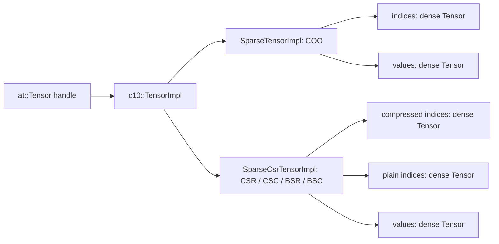

# PyTorch 稀疏张量：语义、框架与源码导读

比较基线为 PyTorch `v2.9.0` 源码及 `2.9` 文档。下文区分上游事实与对 Infini 的设计启示；不把存在的源码注册理解为所有设备、dtype、layout 都可执行。

## 从逻辑张量到组件存储

稀疏张量的逻辑 shape 与同形稠密张量一致，物理存储是 indices 与 values 等组件。未存储坐标通常按零参与稠密解释；已存储的值可以是零，同一 COO 坐标也可以重复。因此 `nnz` 表示存储条目数，不能用 `count_nonzero(values)` 替代。COO 合并重复项后仍可能留下显式零。[COO 实现字段与不变量](https://github.com/pytorch/pytorch/blob/v2.9.0/aten/src/ATen/SparseTensorImpl.h)

例如 shape=(3,4) 的 COO：

```text
indices = [[0, 0, 2, 2],
           [1, 1, 0, 3]]
values  = [ 2, 3, 0,-1]
nnz     = 4

coalesce 后：
indices = [[0, 2, 2],
           [1, 0, 3]]
values  = [ 5, 0,-1]
nnz     = 3

dense   = [[0, 5, 0, 0],
           [0, 0, 0, 0],
           [0, 0, 0,-1]]
```

这里逻辑 numel=12，存储条目从 4 变为 3，数值非零坐标为 2；三者各有用途。任何对齐实现都需要同时验证结构和数值。

## 五种通用布局

记 `S` 为 COO sparse 维度数、`D` 为尾部 dense shape、`B` 为 compressed batch shape、`N` 为 COO 总存储条目数或 compressed 每批存储条目数、`(M,K)` 为矩阵逻辑尺寸、`(br,bc)` 为块大小。

| layout | 组件与 shape | 约束/解释 |
| --- | --- | --- |
| COO | indices=`[S,N]`，values=`[N,*D]` | sparse 维在前、dense 维在后；indices 为 int64；支持未合并重复坐标 |
| CSR | crow=`[*B,M+1]`，col=`[*B,N]`，values=`[*B,N,*D]` | 压缩行，索引列；两个稀疏维 |
| CSC | ccol=`[*B,K+1]`，row=`[*B,N]`，values=`[*B,N,*D]` | 压缩列，索引行 |
| BSR | crow=`[*B,M/br+1]`，col=`[*B,N]`，values=`[*B,N,br,bc,*D]` | N 是块数，逻辑矩阵尺寸应可整除块尺寸 |
| BSC | ccol=`[*B,K/bc+1]`，row=`[*B,N]`，values=`[*B,N,br,bc,*D]` | 块列压缩；不能仅把 BSR 改名 |

compressed 家族使用 int32 或 int64 索引，两种索引组件 dtype 一致；batch 表示要求每批相同 N，而不是任意变长的 CSR 列表。hybrid 表示每个稀疏条目携带尾部 dense 子张量。以上是表示能力，不能推导所有运算都支持 batch、block 或 hybrid。[compressed 构造与维度校验](https://github.com/pytorch/pytorch/blob/v2.9.0/aten/src/ATen/native/sparse/SparseCsrTensor.cpp)、[CSR 公共参数](https://docs.pytorch.org/docs/2.9/generated/torch.sparse_csr_tensor.html)

`torch.sparse_coo_tensor` 会把传入的 indices 转成 LongTensor；Infini 的借用型 C++ 入口若只接受 int64、不自动转换，应明确为低层适配差异。省略 size 的推断也不能保留所有尾部空行/空列，Infini 首期要求显式 shape。[COO 工厂](https://docs.pytorch.org/docs/2.9/generated/torch.sparse_coo_tensor.html)

## COO 的 coalesced 语义

未 coalesced COO 中同坐标条目按加法解释。coalesce 排序并合并重复坐标，合并后的坐标唯一且有序；标记为 coalesced 不是执行了 coalesce。公开 `.indices()` / `.values()` 要求已 coalesced，低层 `._indices()` / `._values()` 可用于内部未合并表示。非线性运算不能不加判断地只处理每个 raw value。[COO 访问与 coalesce 实现](https://github.com/pytorch/pytorch/blob/v2.9.0/aten/src/ATen/native/sparse/SparseTensor.cpp)

已 coalesced 输入的 `coalesce()` 可直接返回自身。Infini 调用者提供 out 的版本允许写入独立缓冲，但必须记录 alias 行为与上游不同；不能为了模拟返回自身而让 caller-owned out 指向临时内存。COO 的排序状态与 dense component 的连续性是两个独立属性。

compressed 的完整校验要求 compressed 首项为零、末项为 N、非递减，plain index 有界且每段有序无重复；非法 compressed 输入不应被当作“未 coalesced CSR”。此处核查依据包括本机源码和文末探针；[固定版本校验器路径](https://github.com/pytorch/pytorch/blob/v2.9.0/aten/src/ATen/native/sparse/ValidateCompressedIndicesCommon.h) 本次未能取回，纳入后续固定基线复核。

## PyTorch 的对象层次



COO 的实现保存 sparse/dense 维数、indices、values 和 coalesced 状态。compressed 实现通过 `layout_` 共用三组件表示，类名含 Csr 并不意味着只支持 CSR。整体 sparse 不提供可直接用于线性地址计算的 dense strides/storage offset；真实数据存储在组件张量中。[SparseTensorImpl](https://github.com/pytorch/pytorch/blob/v2.9.0/aten/src/ATen/SparseTensorImpl.h)、[SparseCsrTensorImpl](https://github.com/pytorch/pytorch/blob/v2.9.0/aten/src/ATen/SparseCsrTensorImpl.h)、[compressed 特殊访问实现](https://github.com/pytorch/pytorch/blob/v2.9.0/aten/src/ATen/SparseCsrTensorImpl.cpp)

Infini 应借鉴“逻辑外壳 + 组成张量”的分层；当前 RT 非拥有型 view 不具备 PyTorch Tensor 的存储引用计数和版本管理，不能照抄类继承后就认为获得相同生命周期或 autograd 能力。

## 从 API 到 kernel 的代码路线

| 阅读顺序 | 固定版本源码 | 关注点 |
| --- | --- | --- |
| 1. layout 定义 | [c10/core/Layout.h](https://github.com/pytorch/pytorch/blob/v2.9.0/c10/core/Layout.h) | 布局与 dtype/device 是不同维度 |
| 2. COO 对象 | [aten/src/ATen/SparseTensorImpl.h](https://github.com/pytorch/pytorch/blob/v2.9.0/aten/src/ATen/SparseTensorImpl.h) | 组件、逻辑 shape、coalesced 不变量 |
| 3. compressed 对象 | [aten/src/ATen/SparseCsrTensorImpl.h](https://github.com/pytorch/pytorch/blob/v2.9.0/aten/src/ATen/SparseCsrTensorImpl.h) | 四种布局如何共享表示 |
| 4. 分派键 | [c10/core/DispatchKey.h](https://github.com/pytorch/pytorch/blob/v2.9.0/c10/core/DispatchKey.h) | Sparse、SparseCsr 功能族与 CPU/CUDA 等 backend 的组合 |
| 5. schema/注册 | [native_functions.yaml](https://github.com/pytorch/pytorch/blob/v2.9.0/aten/src/ATen/native/native_functions.yaml) | 搜索 `_coalesce`、`mm`、`addmm`、`sparse_sampled_addmm`；逐算子注册布局能力 |
| 6. COO 工厂与运算 | [native/sparse/SparseTensor.cpp](https://github.com/pytorch/pytorch/blob/v2.9.0/aten/src/ATen/native/sparse/SparseTensor.cpp) | 构造、组件访问、规范化及前置条件 |
| 7. compressed 工厂 | [native/sparse/SparseCsrTensor.cpp](https://github.com/pytorch/pytorch/blob/v2.9.0/aten/src/ATen/native/sparse/SparseCsrTensor.cpp) | batch/dense/block 维数和组件检查 |
| 8. compressed 运算 | [native/sparse/SparseBlasImpl.cpp](https://github.com/pytorch/pytorch/blob/v2.9.0/aten/src/ATen/native/sparse/SparseBlasImpl.cpp) | 运算辅助、实现选择与支持条件；本次 tag 文件未能取回 |
| 9. CUDA provider | [native/sparse/cuda/SparseBlasImpl.cpp](https://github.com/pytorch/pytorch/blob/v2.9.0/aten/src/ATen/native/sparse/cuda/SparseBlasImpl.cpp) | 供应商调用、临时资源与支持条件 |
| 10. 梯度注册 | [tools/autograd/derivatives.yaml](https://github.com/pytorch/pytorch/blob/v2.9.0/tools/autograd/derivatives.yaml) | forward/backward 分开注册，不能按布局笼统承诺 |

`SparseCPU` / `SparseCUDA` 主要对应 COO，`SparseCsrCPU` / `SparseCsrCUDA` 覆盖 compressed 家族；同一家族还需运行时 layout 检查。Infini 可继续复用自己的 provider 注册，只增加布局能力判断，无需复制所有 PyTorch dispatch keys。[DispatchKey 源码](https://github.com/pytorch/pytorch/blob/v2.9.0/c10/core/DispatchKey.h)

schema 的 `Tensor` 参数本身不告诉生成器是 dense 还是 sparse。布局还来自运行时对象、注册目标及具体 kernel 约束，这正是 Infini 的自动 wrapper 需要显式 layout contract 的原因。[算子 schema 与注册](https://github.com/pytorch/pytorch/blob/v2.9.0/aten/src/ATen/native/native_functions.yaml)

## sampled_addmm：必须保护存储结构

上游公共接口要求 input 为 CSR，mat1/mat2 为 dense。结合下述固定版本梯度实现，其采样含义应按 CSR 存储位置理解：每个存储项 p 的输出为 `alpha * dot(mat1[row], mat2[:,col[p]]) + beta * input.values[p]`，包括 value 为零的存储位置。[API](https://docs.pytorch.org/docs/2.9/generated/torch.sparse.sampled_addmm.html)、[CSR 梯度中的结构采样](https://github.com/pytorch/pytorch/blob/v2.9.0/torch/csrc/autograd/FunctionsManual.cpp#L1415)

文档中对 mask 的“non-zero values”文字容易误读为需要重新按数值筛选。源码中的 CSR 梯度路径先把 values 清零再调用 sampled_addmm，也说明零值不会删除采样结构。[FunctionsManual.cpp 中 CSR 路径](https://github.com/pytorch/pytorch/blob/v2.9.0/torch/csrc/autograd/FunctionsManual.cpp#L1415)

可用一个独立解析用例验证：CSR shape=(1,2)，crow=[0,2]、col=[0,1]、values=[0,2]；mat1=[[2,3]]，mat2=[[4,5],[6,7]]，alpha=beta=1。预期 values=[26,33]，输出仍有两个存储项。

## 校验、求导与半结构稀疏的边界

PyTorch 完整 sparse invariant 检查默认关闭，可通过构造参数或上下文打开；这是一种性能选择，并不意味着非法索引安全。Infini 需要独立规定可信来源、元数据检查与设备内容检查，不能仅依赖 Debug assert。[invariant 检查 API](https://docs.pytorch.org/docs/2.9/generated/torch.sparse.check_sparse_tensor_invariants.html)

autograd 支持取决于算子、参数、layout、backend 和 dtype。2.9 的 sparse.mm 文档仍有 CSR 梯度限制说明，但同版本源代码存在 CSR backward 路径；不能据此概括为“CSR 全面无梯度”或“所有 CSR 都可求导”。本方案首期 forward-only，后续以注册、代码和实测的逐组合矩阵判断。[mm 文档](https://docs.pytorch.org/docs/2.9/generated/torch.sparse.mm.html)、[梯度注册](https://github.com/pytorch/pytorch/blob/v2.9.0/tools/autograd/derivatives.yaml)、[梯度实现](https://github.com/pytorch/pytorch/blob/v2.9.0/torch/csrc/autograd/FunctionsManual.cpp)

半结构稀疏的 `SparseSemiStructuredTensor` 使用 Python subclass / dispatch 和 packed/metadata 表示，涉及特定供应商库及硬件限制。它应独立规划，不作为普通 compressed layout 的无差别扩展。[semi_structured.py](https://github.com/pytorch/pytorch/blob/v2.9.0/torch/sparse/semi_structured.py)

## 本次补充探针的证据边界

只读研究中使用本机 `torch 2.10.0a0+b4e4ee81d3.nv25.12` 做了四项小型语义探针：COO int32 构造后变为 int64；启用校验时 CSR 乱序和重复 indices 均被拒绝；上述 sampled_addmm 显式零用例输出 [26,33]。这些结果只作为补充，**不当作 v2.9.0 或 InfiniOps 的测试通过记录**。

本机 `/opt/pytorch/pytorch` 有源码，但 git 元数据不可用于确认提交，因此文档以公开固定 tag 链接为主要实现证据。后续 CI 必须安装固定测试基线并记录完整 `torch.__version__`、设备和依赖版本。

有三份公开 tag 文件在本次浏览中未能取回：`native/sparse/ValidateCompressedIndicesCommon.h`、`native/sparse/SparseBlasImpl.cpp`、[native/cpu/SampledAddmmKernel.cpp](https://github.com/pytorch/pytorch/blob/v2.9.0/aten/src/ATen/native/cpu/SampledAddmmKernel.cpp)。链接仅作为后续阅读定位，不表示已成功读取该版本文件。本机对应源码已作辅助阅读；涉及其独有细节的实现任务，应在 P0/P1 的固定版本源码或测试环境中复核。sampled_addmm 的结构 mask 判断另有已读的 v2.9.0 `FunctionsManual.cpp` 及标明版本的本机探针支撑。

## D0 固定版本复核

2026-11-12 的 D0 补读已取回上述三份 v2.9.0 文件，以及 sampled_addmm 的 CPU 外层实现；上一节的取回失败记录保留为早期分析历史。本次通过官方 `raw.githubusercontent.com/pytorch/pytorch/v2.9.0/` 获取文件，不以其他版本源码代替：

| 固定文件 | 本次确认 |
| --- | --- |
| [ValidateCompressedIndicesCommon.h](https://github.com/pytorch/pytorch/blob/v2.9.0/aten/src/ATen/native/sparse/ValidateCompressedIndicesCommon.h) | compressed 首末值、单调性、plain bounds、逐段严格有序且唯一；检查 compressed/plain 逻辑维度及 nnz 在 index dtype 中可表示 |
| [SparseBlasImpl.cpp](https://github.com/pytorch/pytorch/blob/v2.9.0/aten/src/ATen/native/sparse/SparseBlasImpl.cpp) | 已取回并阅读；不能用其中普通 addmm/addmv 的 beta 分支推断 sampled_addmm |
| [SampledAddmmKernel.cpp](https://github.com/pytorch/pytorch/blob/v2.9.0/aten/src/ATen/native/cpu/SampledAddmmKernel.cpp) | 遍历每个 CSR 存储项；scalar 转为 value dtype，逐项计算 alpha 乘点积加 beta 乘旧值，无零 scalar 忽略分支 |
| [SparseBlas.cpp](https://github.com/pytorch/pytorch/blob/v2.9.0/aten/src/ATen/native/sparse/SparseBlas.cpp) | `sparse_sampled_addmm_out_sparse_csr_cpu` 先复制 input；空 operand 或零 nnz 时 values 乘 beta，否则调用上述 CPU kernel |

由这两个 sampled_addmm 调用层可确定 CPU beta=0 仍传播 input NaN/Inf；alpha=0 的非空点积也不跳过 NaN/Inf。空内积只按 beta 缩放 input。这项源码推导已写入 [D0 数值契约](06-d0-contract.md#数值与特殊值冻结)，没有泛化成所有 GPU provider 的上游事实。D0 没有运行 v2.9.0 数值测试，后续 OP6/GPU1 仍须给出固定环境运行证据。
