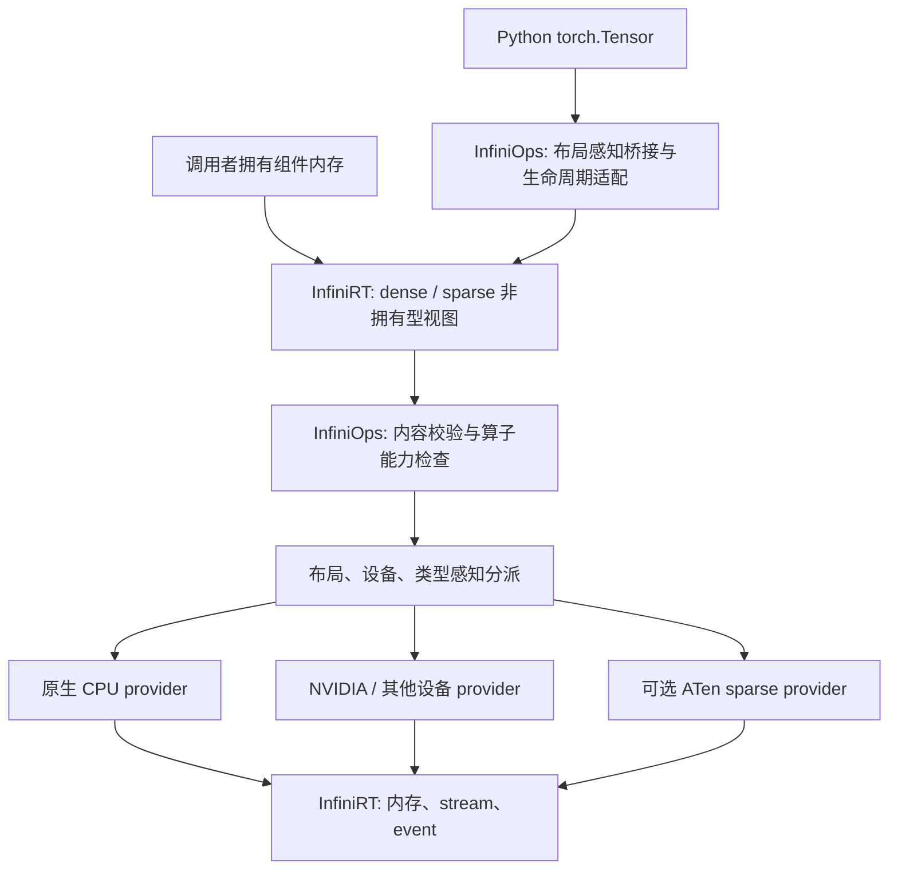

# 目标设计与接口契约

本文是总体设计；首期类型职责、错误和执行协议已由 [D0 契约](06-d0-contract.md) 冻结，新类型和接口仍不是现有 API。早期建议与 D0 决议有差异时以 D0 为准。设计遵守仓库的 C++ 正式入口、输入/属性/输出分组、调用者提供输出缓冲区的原则；相对 PyTorch 的差异显式列出。

## 架构选择

| 方案 | 收益 | 代价 | 决策 |
| --- | --- | --- | --- |
| 给现有 `TensorView` 塞入多布局 payload | 单一入参类型 | 改对象大小、ABI、hash、dense 热路径；旧 kernel 可能读错数据 | 首期不采用 |
| 新增 `SparseTensorView`，组合现有组件视图 | 保持 dense 边界，改造可增量推进 | sparse 算子/生成器需要显式类型支持 | D0 已采用 |
| 复制 PyTorch `TensorImpl` 层次和 owning Tensor | 接近 PyTorch 内部对象模型 | 新建存储、引用计数、分派和版本系统，超出两库当前定位 | 不采用 |

`Tensor` 暂时仍是 `TensorView` 别名。可在未来确有多布局通用算子需求时引入只用于入参的带标签 `TensorArg`，但不能用它默默替换现有别名。第一阶段通过显式 sparse 类型和重载接入现有 operator 架构。

## InfiniRT 表示与生命周期

### 逻辑元数据和物理组件

`SparseTensorView` 是可复制的非拥有型描述符：拥有自己的 shape 元数据，复制组件视图的元数据，借用组件数据。不得借用临时 `TensorView` 的 `shape()` 返回值。稀疏描述符复制不会延长 data 生命周期，也不分配设备内存。

| 字段/概念 | 契约 |
| --- | --- |
| `layout` | 枚举预留 COO / CSR / CSC / BSR / BSC；未实现构造入口返回不支持 |
| `shape`、`sparse_dim`、`dense_dim`、`batch_dim` | 逻辑尺寸和维度分解；首期仅二维、两个 sparse 维度 |
| `dtype`、`device` | value 类型及所有组件共同的完整设备 `(type,index)` |
| `nnz` | COO 为整个 indices 的列数；compressed 为每批相同的存储条目数；block 布局计块，不等于非零标量数 |
| COO payload | dense `indices` 视图和 dense `values` 视图；COO 的 coalesced 状态 |
| compressed payload | dense compressed indices、plain indices、values 视图；由 layout 决定行/列意义 |
| block shape | 由 values 维度推导并校验，与逻辑 shape 整除关系一致 |
| `numel` | 逻辑 shape 乘积，必须检查溢出；不能用作组件存储大小 |

稀疏对象不暴露整体 `data()`、`strides()`、`IsContiguous()`、指针算术切片或无条件 `T()`。这些概念仅适用于 dense 组件。`values()` 的 dtype 是 value dtype；索引 dtype 单独查询。提供语义明确的组件访问器，而不是要求调用者猜测 `data[0]` 的意义。

COO 的 `indices()/values()` 对外保持需要 coalesced 的语义；桥接未 coalesced 输入所需的 raw component 访问仅作为明确标注的低层接口，不自动排序。CSR 的 `crow_indices()/col_indices()/values()` 不要求 COO 式 `coalesce()`。

### 校验边界

InfiniRT 负责不读取数据内容的结构校验：组件数量、rank、shape、dtype、完整 device 一致性、非空区域指针及元素自然对齐、布局支持、乘法/加法溢出、index dtype 可表示范围。组件首期要求连续；shape 可为零，但 CSR 的指针数组仍具有 `rows+1` 个元素。对零长度数组不解引用 data。

InfiniOps 负责需要扫描 CPU 或设备数据的校验：COO bounds、coalesced 声明真实性、compressed 起止值/单调性、plain indices 的范围和逐段严格递增。校验 GPU 数据必须通过设备 kernel 或明确同步的检查路径，不能由 host 解引用。

RT 工厂只执行 metadata 校验，不读取组件内容、不提交设备工作、不隐式同步。Ops 的外部 checked import / 显式校验入口默认完整校验；同步接口明确允许等待，异步接口返回完成句柄和 caller-owned 结果槽。提交成功不等于内容校验成功。裸 C++ 调用方从 RT view 进入 Ops 时，须完成该校验，或满足明确的可信来源契约；算子不能在校验失败后继续运行可能越界的 kernel。

可信内部算子输出允许跳过重复扫描。与 PyTorch 默认关闭完整 invariant 检查存在有意差异：RT 借用的裸指针没有 PyTorch 的所有权和版本体系。不把未经验证的 `is_coalesced=true` 当作排序已完成。可信模式的前置条件是结构由已验证算子产生，且索引未被修改；该模式不对非法外部指针提供保护。

拟新增的描述符/校验 API 返回可检查的 `ValidationResult`，区分非法元数据、不支持布局、索引越界、整数溢出和容量不足。它是新设计，不复用/伪称现有 `runtime::Error` 已包含这些状态。遵守 C++ 不抛异常原则，且公共非法输入拒绝在 Release 中也有效。D0 已记录并写入 Ops 贡献规范的专用决议：此边界 assert 仅用于内部不变量，外部稀疏输入使用显式检查结果；不改写全仓 dense 错误体系。Python 边界按 [D0 状态表](06-d0-contract.md#结果与-python-异常映射) 翻译异常。

现有 `Operator::Call` 通常返回 void，部分 provider 选择路径实际抛 `std::invalid_argument`，不能声称已经满足此 status 设计。D0 确定新增 sparse checked entry / Prepare / Execute，在进入旧分派前检查 provider 存在性、显式 implementation 是否支持、workspace 和容量，并把可预期失败返回为状态；执行路径不能再无条件落入会抛错的旧选择分支。各状态与 Python 异常映射已在 D0 冻结。ATen provider 自身可能抛框架异常，其边界须局部捕获并转为失败状态；这属于有文档记录的互操作适配，不新增向 C++ 调用者抛出的异常。

### 内存、异步与结构变更

调用者同时保活 indices、values、output、workspace，直到消费它们的 stream 完成；一份 sparse view 不承担释放责任。RT 的 allocator/stream/event 继续处理字节和执行依赖，不加入 SpMM、排序、coalesce 或 ATen 依赖。

对于多 stream：生产组件后在 producer stream 记录 event，consumer stream 等待 event；所有读取结束后方可修改结构或释放任何组件。`FreeAsync` 必须排在最后一次使用之后；只在单个 stream 上 free，不能证明其他 stream 已完成。CPU backend 和缺少 event/async 功能的设备采用明确同步的受限路径。

结构指 indices、shape、layout、nnz、block shape 和 coalesced 状态。调用期间禁止外部结构变更；修改 indices 后必须重新校验、清除 coalesced 证明并重建依赖结构的 plan。仅修改 values 也须满足 stream 顺序，但无需使纯符号分析失效。借用视图无法拦截外部写入，不能假装自动维护了可靠版本计数。

跨设备复制按组件分别复制，并更新整个描述符的 device；目标描述符在复制完成之前必须携带相应执行依赖，不能作为无依赖输入消费。首期不新建一个不透明的“复制整张 sparse”运行时接口。需要重新校验容量与设备依赖。未来 owning wrapper 的 allocation group 可以统一释放多个 buffer，但不是首期前置条件。

## InfiniOps 算子与接口语义

### 首期公共契约

下表是契约级表示，最终声明需经生成器与公共头核查；没有提供可直接运行的实现。

| 操作 | 上游公共对象 | 建议输入 → 输出 | 对齐/差异 |
| --- | --- | --- | --- |
| COO / CSR 构造 | `torch.sparse_coo_tensor` / `torch.sparse_csr_tensor` | 显式 shape + 借用组件 → 稀疏视图 | 低层自定义适配；不支持自动推断 shape、拷贝、requires_grad |
| Coalesce | `Tensor.coalesce` | COO → coalesced COO | 同坐标求和，字典序排序；输出缓冲由调用者提供 |
| ToDense | `Tensor.to_dense` | COO / CSR → dense out | 包含 COO 重复坐标求和；不承诺 autograd 的 masked_grad |
| ToSparseCsr / ToSparseCoo | Tensor 的布局转换 | 二维 COO ↔ CSR | COO→CSR 必须处理重复；CSR→COO 保持已存储条目 |
| SparseMm | `torch.sparse.mm` | sparse mat1、dense mat2、reduce 属性 → dense out | 首期只有 reduce=sum；稀疏右输入及其他 reduce 明确拒绝，属于部分覆盖 |
| SparseSampledAddmm | `torch.sparse.sampled_addmm` | CSR input、dense mat1、dense mat2、beta、alpha → CSR out | output pattern 与 input 一致，数值与结构均需验证 |

输入、属性、输出分组遵守 [API 对齐规范](../operator-api-alignment.md)。可显式接受 `reduce` 并拒绝非 sum，不能无声忽略。`double` alpha/beta 首期对应实数 dtype；不声称已覆盖 PyTorch complex Scalar。构造的显式 shape 保留尾部空行/空列，并避免为推断尺寸而扫描设备。

按该规范评审时，借用型视图工厂属于 `Custom` 低层接口；显式 out 和参数分组属于可接受的 C++ adaptation。`SparseMm` 对 sparse 右输入及非 sum reduce 的缺失应登记为 `Needs remediation / deferred`，不能因默认路径可用而标记全面对齐。其余算子也只在已声明的二维、前向、dtype 范围内评审语义，完整公共 API 的 batch/hybrid、梯度和其他属性差距保持可见。这里是未来接口的评审分类，不是已实现状态。

首期 `SparseMm` 接受未 coalesced COO：provider 可以直接按重复条目累加，或在公开 workspace 契约内先 coalesce；不能改变数学含义。非线性 sparse 运算后续必须先处理重复项，例如对重复的 1 和 -1 分别 ReLU 与先合并再 ReLU 结果不同。

`SparseSampledAddmm` 当前 dense 签名不能表达合法 CSR input。新增 sparse 签名为 canonical，旧签名保留迁移诊断，不将 dense 参数猜测成 CSR。先使用手写 sparse ATen provider 或原生 CPU provider，不因 YAML 中存在同名条目就让通用生成器自动接管。

sampled_addmm 按存储坐标计算，显式零仍参与采样。数学表达是每个条目 p 写入 `alpha * dot(mat1[row], mat2[:,col[p]]) + beta * input.values[p]`，保持 input pattern；不能按 `values != 0` 重建 mask。D0 已核验 v2.9.0 CPU 路径没有 beta=0 忽略 input 的分支；NaN/Inf、alpha=0 和空内积按 [特殊值契约](06-d0-contract.md#数值与特殊值冻结) 处理。GPU 必须单独验证，不能套用 dense addmm 的规则。

### 输出容量和动态 nnz

对于 SpMM / ToDense，输出逻辑 shape 已知，调用者提供 dense out，执行期间不替换 data。对于 sampled_addmm，输出 CSR 的 nnz 与 input 相同，预分配并写入相同 pattern；首期不允许 in-place 或 input/out 重叠。其 out-only 描述只校验 metadata/容量，不能按输入扫描尚未初始化的索引。对于 CSR→COO，nnz 已知。

首期所有 sparse 算子的输出、workspace、结果槽写入区间与输入组件/输入 dense operands 不得重叠，各写入区间彼此也不得重叠。按声明的有效/容量字节区间检查，零长度区间不构成重叠；计算区间端点时检查整数溢出。后续别名支持须逐算子明确开放，不能由现有 dense 行为推断。

对于 coalesce、COO→CSR、dense→sparse，实际 nnz 可能取决于内容。D0 确定分为三步，作为 InfiniOps 自定义低层执行协议，不宣称这三个接口来自 PyTorch：

1. **Prepare / 查询容量**：根据元数据给出 workspace、各组件容量上界及所需对齐；coalesce 上界为 input nnz，dense→sparse 上界为逻辑条目数。P2 必须实现上界模式；count-first 是可选扩展，未实现时明确拒绝，GPU count 的主机回读是明确同步点。
2. **Execute**：向 caller-owned 输出组件写数据，并在 caller-owned 结果槽记录 `{status, actual_nnz}`。GPU 上结果槽可位于设备；初始为 pending，提交状态与完成状态区分。任何容量检查失败都不能越界写入。不能把容量当作有效 nnz 传给后续算子。
3. **Finalize**：CPU 立即、GPU 在 event/stream 完成后读取状态和实际 nnz，仅在成功时构造有效组件 shape 和结果 sparse view。失败时输出不发布，已部分写入的内容不可使用；不默认承诺失败事务回滚。此阶段不拷贝 values，coalesced 标记由成功执行结果确定。GPU→host 结果回读成本必须可见。

输出描述应区分 `capacity` 与 `nnz`。建议用专用 mutable output 描述及独立结果元数据槽，不修改按值传入的视图来“返回”新的 shape。只有 Finalize 后，输出才可作为普通 sparse input 使用。实际结果槽和缓冲区均由调用者持有，避免临时 plan 析构后留下悬空指针。

mutable output 描述的是可用字节容量，不把 capacity 伪装成最终 shape。COO indices 若先按 `[2,capacity]` 写入，不能仅缩 shape 成 `[2,nnz]`：第二行的偏移会错误或变为非连续。Execute 在获知实际 nnz 后必须把 indices 打包为连续 `[sparse_dim,nnz]`，中间缓冲/搬运计入 workspace。Finalize 只建立与已写入布局一致的视图。CSR 的 plain indices/values 可用有效前缀，COO indices 不能套用该规则。

输入在 Prepare 和 Execute 之间不得改变；count-first 分配需要绑定同一结构版本，dense→sparse 还必须保证参与计数的 values 未变。首期动态 nnz 流程不支持 graph capture；后续仅在证明固定地址、容量、结构和设备端结果消费协议后开放。

### 分派、能力和缓存

继续使用 `Operator<Key, Device, Index>`，通过参数 traits、provider `supports` 和构造前验证引入布局条件。不要让“设备相同”隐含“布局支持”。检查所有输入和输出的设备 index，而非只取第一个 tensor 的 device type。

能力记录至少包含：输入/输出 layout 组合、value dtype、index dtype、rank、batch/hybrid、组件连续性、是否接受未 coalesced COO、reduce、设备、capture 能力。未支持组合立即返回清晰结果；不默认 densify、隐式换设备或截断 int64 索引。半精度累加、转索引和格式转换只有显式支持后才启用。

| 缓存对象 | 可以按什么复用 | 禁止行为 |
| --- | --- | --- |
| 普通算子元数据缓存 | layout、shape、nnz、维度分解、component shape/strides、value/index dtype、device、block shape、规范化状态、影响算法的属性 | 把同几何的 COO 和 CSR 当成同一参数；在其中保存旧 data 指针 |
| 稀疏结构分析 plan | 调用者显式持有、绑定所有者/组件地址/结构身份；结构稳定期内可复用 | 仅按 shape+nnz 或裸地址复用，外部修改索引或地址回收后仍使用旧分析 |
| tuning 选择 | 首期关闭 sparse 在线 tuning；后续单独制定包含布局和稀疏分布的签名与受控采样 | 用现有 shape+dtype 签名复用任意稀疏模式的最优算法 |

首期 metadata cache 中只保存不依赖索引内容的参数；结构相关预处理每次重建，或明确置于 caller-owned plan。若引入 `structure_generation`，只能由拥有/控制结构修改的 wrapper 发号；不能在裸借用视图上提供虚假的自动失效保证。对于同 shape/nnz、不同 indices 的连续调用，这是必须通过的回归用例。

将设备发现、trace、autotuning、cache、`AsCallArg` 和生成器统一接入显式 Dense / Sparse 参数 traits；不能仅修补一个 hash 函数。

## Python 与 ATen 桥接

Python 入口必须先检查 `tensor.layout`，再读取 dense 的 `data_ptr/stride` 或 sparse 的组件。未 coalesced COO 的导入需要 raw 组件读取，不调用要求 coalesced 的 `.indices()`，也不隐式 `.coalesce()`。compressed 按 layout 分别读取 crow/col 或 ccol/row。

新旧重载如果都生成 `py::object`，不能依赖 pybind 按 layout 自动选中正确重载，也不能期待 dense 转换异常后自动回退。Python 使用单一 layout-aware dispatcher（或证明等价的严格 type caster）；只对已识别的 dense 旧调用给迁移诊断。

Python 的动态输出使用显式 output builder：调用方提供容量组件，builder 保活组件及结果槽，Finalize 成功后构造并返回新的 `torch.sparse_*` 对象，组件共享最终有效数据区域。构造出的 PyTorch 组件视图必须仍关联原始存储 owner，不能用无 owner 的裸 for_blob 返回。传入的 sparse out 对象不被隐式替换元数据。GPU Finalize 若需要 host nnz，明确同步；首期动态输出不提供“立即返回但看似已完成”的 Python Tensor。固定 shape 的 dense 输出和固定 pattern CSR 输出保持普通 caller-provided out 形式。

ATen 侧先用现有 dense external wrapping 包装每个组件，再构造对应 sparse ATen tensor，显式传入逻辑 size、layout、dtype、device 与 coalesced 状态。不能把 values 的 data 指针和整体逻辑 shape 交给 `ToAtenTensor`。PyTorch 分派自然基于构造出的真实 layout 选择 sparse kernel。

临时 ATen tensor 并不拥有外部内存。需继承现有 device/stream guard，并为 Python 导入组件保留强引用到消费结束：原生 CUDA kernel 不会自动通知 PyTorch caching allocator。推荐 NVIDIA 适配以持有组件引用及登记 consumer stream 使用（经验证的 `record_stream` 或 event 完成队列）实现；其他后端未证明等价机制前，使用明确同步的受限桥接。仅持有到 Python 函数返回不满足异步生命周期要求。

ATen 的 sparse out 可能重分配或替换组成张量，不能让其悄悄逃离 caller-owned 输出。先检查实际 `_out` 实现；无法证明组件地址稳定时，使用临时 ATen 结果，再按显式容量校验复制各组件到调用者输出，并记录这一额外开销。动态 nnz 仍走 Prepare/Execute/Finalize 协议。原生 provider 可避免此拷贝。

首期为 forward-only：Python 桥接对需要梯度的输入显式拒绝或要求调用者主动 detach，不返回外观看似可反传但已断开图的结果。自动求导未来由更高层定义 values 梯度和布局传播；indices 不作为可求导参数。

## 向更多布局扩展

CSC 与 CSR 共享 compressed payload，但 compressed axis、转置和供应商接口不能混用。BSR/BSC 的 nnz 是块数，values 包含两个 block 维度，校验 logical dimensions 可整除 block dimensions。首期不通过硬编码“values.rank=1”封死后续表示，首期工厂仍拒绝不支持的 dense_dim/batch_dim。

batch compressed 的组件采用 PyTorch 的规则：每批相同存储条目数。变长 batch 需要不同的抽象，不冒充该布局。hybrid COO 允许 sparse 维度后的 dense value block；其 coalesce 对整个 block 求和。扩展阶段必须同时交付表示、转换、能力和测试，不能只增加枚举值。

2:4 半结构稀疏与通用 COO/CSR 分开立项：它涉及打包值/metadata、硬件和 dtype 限制，不作为 BSR 的别名或默认底层实现。
